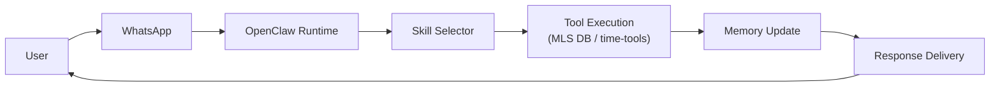
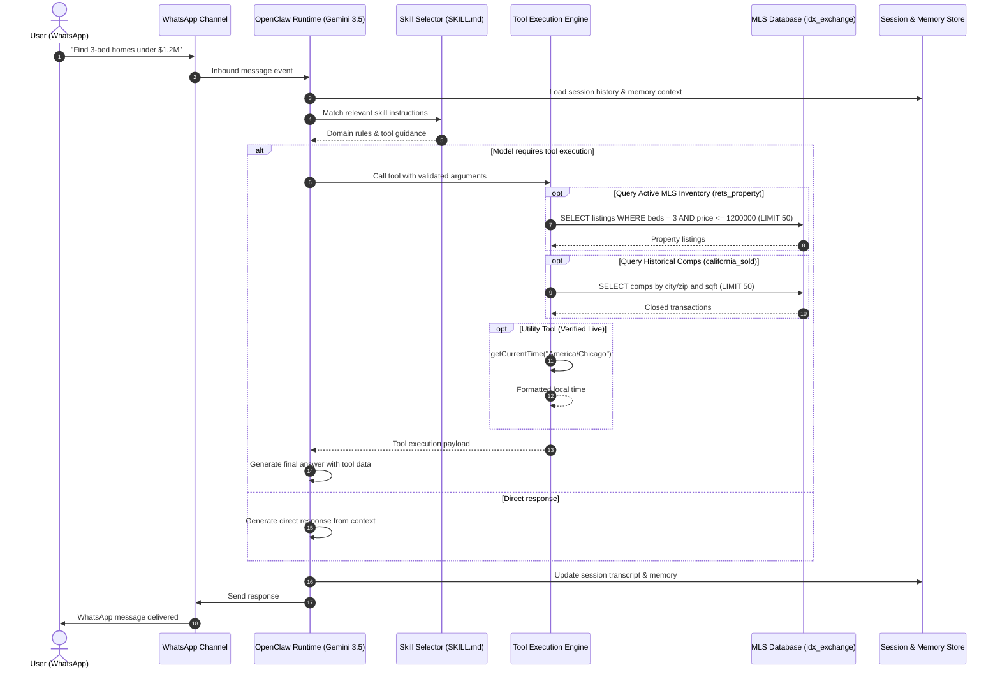
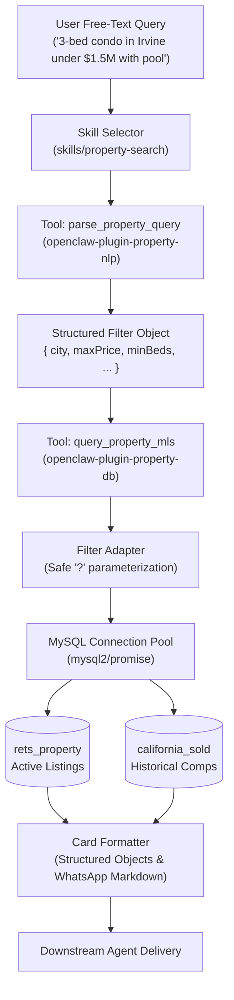

# IDX Exchange — OpenClaw Architecture Fundamentals (Week 1)

Reference architecture documentation and query lifecycle for the IDX Exchange agentic real estate assistant.

---

## Architecture Flow

The end-to-end lifecycle follows OpenClaw's core message processing pipeline:



---

## Detailed Workflow Diagram

This sequence traces how an inbound user query flows through OpenClaw skills to external tools and databases:



---

## Key Components

OpenClaw coordinates six core architectural layers:

1. **Skills** — Modular capability units defined in declarative markdown (`SKILL.md`). They teach the model *how to reason*, which tools to select, and domain-specific rules (e.g., real estate search heuristics).
2. **Channels** — Communication interfaces connecting OpenClaw to messaging platforms. Week 1 uses the WhatsApp gateway, mapping phone numbers to isolated user sessions.
3. **Sessions** — Persistent, per-user state storage ensuring conversation turns, context windows, and message history remain isolated between users.
4. **Tools** — Typed async functions that perform real procedural work and I/O. Tools require explicit allowlisting in `openclaw.json` (`tools.alsoAllow`), while raw shell access is denied (`tools.deny = ["exec"]`).
5. **Memory** — Hybrid storage combining short-term conversation session history with long-term vector/keyword retrieval for past client preferences.
6. **Orchestrator** — The central runtime daemon driving the LLM (`google/gemini-3.5-flash-lite`), routing incoming queries to the appropriate skill, handling retries, and managing tool calls.

---

## Tool Definition Pattern

Tools are implemented as typed async functions that execute procedures and return structured JSON:

```typescript
export async function getCurrentTime(timezone: string = "UTC") {
  return { 
    currentTime: new Date().toLocaleString("en-US", { timeZone: timezone }),
    iso: new Date().toISOString()
  };
}

export async function handleMessage(message: string) {
  if (message.toLowerCase().includes("time")) {
    return await getCurrentTime();
  }
  return { response: "I could not understand the request." };
}
```

---

## Natural Language Property Search & Database Architecture (Week 2 & Week 3)

The pipeline connects natural language parsing (`property-nlp`) with parameterized MySQL querying and card formatting (`property-db`):



### Supported Filters & Mapping to `rets_property`

| Filter Key | Semantics | DB Column | Target Type | Example | DB Storage Format |
| :--- | :--- | :--- | :--- | :--- | :--- |
| `city` | Match | `L_City` | `string \| null` | `"Irvine"`, `"Newport Beach"` | `varchar(50)` |
| `maxPrice` | Max (`<=`) | `L_SystemPrice` | `number \| null` | `1500000` | `int` |
| `minBeds` | Min (`>=`) | `L_Keyword2` | `number \| null` | `3` | `int` |
| `minBaths` | Min (`>=`) | `LM_Dec_3` | `number \| null` | `2.5` | `decimal(4,1)` |
| `minSqft` | Min (`>=`) | `LM_Int2_3` | `number \| null` | `2500` | `int` |
| `type` | Match | `L_Type_` | `string \| null` | `"Condominium"`, `"SingleFamilyResidence"` | `varchar(50)` |
| `pool` | Flag | `PoolPrivateYN` | `"True" \| null` | `"True"` | `varchar(50)` (`'1'` = pool) |
| `hasView` | Flag | `ViewYN` | `"True" \| null` | `"True"` | `varchar(50)` (`'1'` = view) |
| `maxHOA` | Max (`<=`) | `AssociationFee` | `number \| null` | `400` | `int` |

---

## MLS Database Layer (`idx_exchange`)

When property queries are executed, tools interface with two relational datasets in MySQL via `property-db`:

* **Active Listings (`rets_property`)**: 55,212 active listings with price, address, beds, baths, square footage, and property amenities.
  - Query function: `searchActiveListings(filters, page, limit)`
  - Safe pagination: requests `limit + 1` rows to calculate `hasMore` without expensive `COUNT(*)` scans.
  - Sorting: strictly `ORDER BY L_SystemPrice ASC, L_ListingID ASC`.
* **Historical Comps (`california_sold`)**: 98,552 closed sales used for pricing comps, DOM, and valuation trends.
  - Query function: `getSoldComps(city, months)`
  - Filters to `PropertyType = "Residential"` and closes within the last N months.
* **Security & Invariant Guarantees**:
  - Read-only queries only (`SELECT`). No `INSERT`, `UPDATE`, `DELETE`, or DDL.
  - 100% parameterization with `?` placeholders. Zero user/filter string interpolation.
  - Strict pagination clamp (limit between 1 and 50) preventing context saturation.
  - Graceful formatting: WhatsApp-friendly bulleted text (no tables), never printing `"null"` or `"undefined"`.

---

## Verified Live Trace

Week 1 verification: executing the toy `time-tools` plugin live over WhatsApp. Below is the exact transcript event log extracted from `openclaw-agent.sqlite`:

```text
[Inbound WhatsApp Event]
User: "What time is it in Chicago?"

[Runtime Dispatch]
Model: google/gemini-3.5-flash-lite
Tool: get_current_time({ "timezone": "America/Chicago" })

[Tool Execution Result]
{
  "currentTime": "Monday, September 28, 2026 at 5:41:26 PM CDT",
  "iso": "2026-09-28T22:41:26.126Z",
  "timezone": "America/Chicago"
}

[Outbound WhatsApp Delivery]
Assistant: "It is currently 5:41 PM (CDT) on Monday, September 28, 2026 in Chicago."
```
